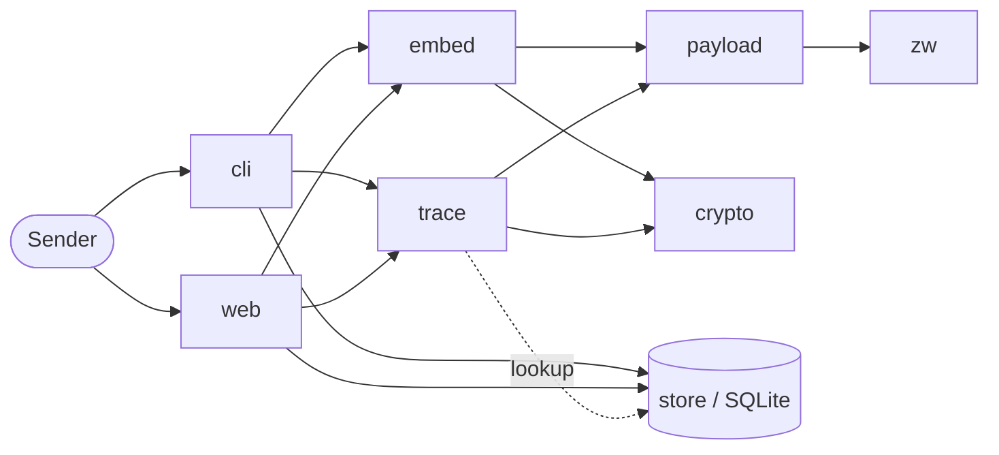
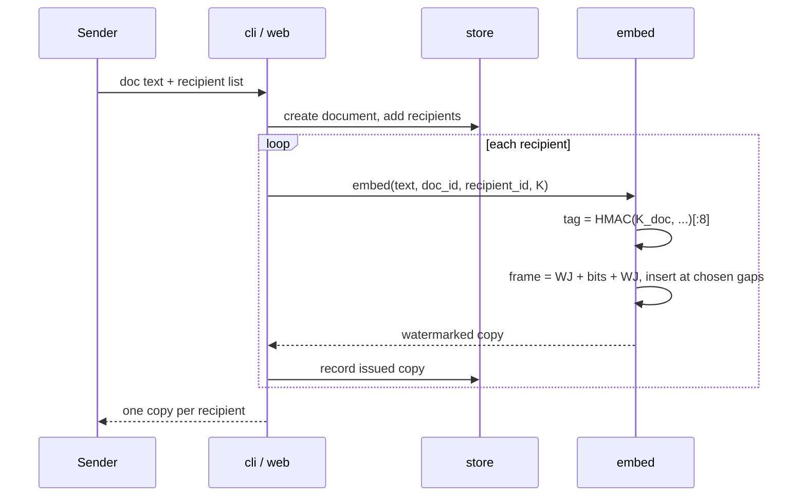
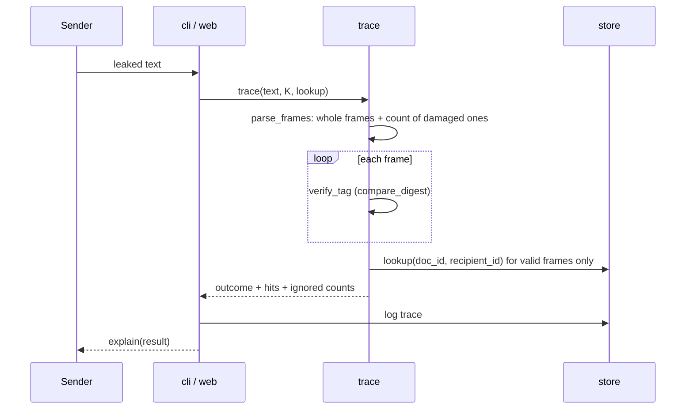
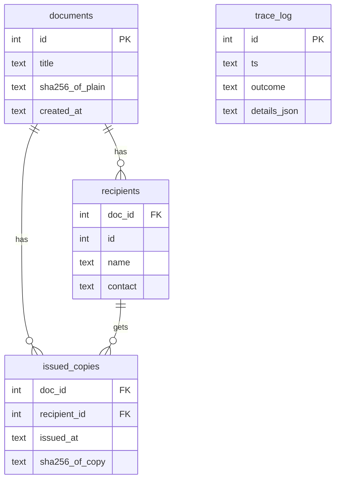

# InkTrace Architecture

## Overview

InkTrace hides a signed, per-recipient code inside plain text using zero-width Unicode characters,
and later reads it back from a leaked copy to find out whose copy it was.

## Components

| Module | File | Job |
|---|---|---|
| `zw` | `src/inktrace/zw.py` | bits to and from zero-width chars, strip, reveal |
| `crypto` | `src/inktrace/crypto.py` | key generate/load/save, per-doc key, HMAC tags |
| `payload` | `src/inktrace/payload.py` | pack/unpack 116 bits, frame, find frames in text |
| `trace` | `src/inktrace/trace.py` | verify every frame, decide the outcome, explain it |
| `embed` | `src/inktrace/embed.py` | pick gaps and insert frames |
| `store` | `src/inktrace/store.py` | SQLite: documents, recipients, issued copies, trace log |
| `cli` | `src/inktrace/cli.py` | `inktrace` command |
| `web` | `src/inktrace/web/` | Flask demo page (localhost only) |

The core (`zw`, `crypto`, `payload`, `trace`, `embed`) uses only the Python standard library.
`trace` does not import `store`. It takes a `lookup(doc_id, recipient_id)` function, so it can be
tested without a database.

## Design

### Zero-width alphabet

| Char | Code point | Role |
|---|---|---|
| ZERO WIDTH SPACE | U+200B | bit `0` |
| ZERO WIDTH NON-JOINER | U+200C | bit `1` |
| WORD JOINER | U+2060 | frame start / end |

One bit per character. It is longer than a 4-symbol alphabet, but it keeps parsing simple and
does not use U+200D (ZWJ), which changes how emoji render. U+FEFF is not used because many tools
strip it as a byte order mark.

### Payload format

116 bits, big-endian:

| Field | Bits | Notes |
|---|---|---|
| `version` | 4 | `1` for now |
| `doc_id` | 32 | document id |
| `recipient_id` | 16 | recipient id within the document |
| `tag` | 64 | truncated HMAC, see below |

A frame is `U+2060 + 116 data chars + U+2060`, so 118 invisible characters.

### Key handling

- Master key `K`: 32 random bytes from `secrets.token_bytes`, kept by the sender only (file or `INKTRACE_KEY`).
- Per-document key: `K_doc = HMAC-SHA256(K, "inktrace-doc" || doc_id)`.
- Tag: `HMAC-SHA256(K_doc, "inktrace-v1" || version || doc_id || recipient_id)`, first 8 bytes.
  `version` is 1 byte, `doc_id` 4 bytes, `recipient_id` 2 bytes, all big-endian.
- Tags are compared with `hmac.compare_digest`.

A 64-bit tag means a random guess passes with probability 2^-64. An attacker cannot test guesses
offline because they do not have `K`, so this is enough for our use.

### Placement in the text

- A gap is a position right after an ASCII space where the characters on both sides are printable
  ASCII. This keeps marks out of words, emoji and Urdu/Arabic text. Gaps next to URLs are skipped.
- A whole frame goes into one gap.
- Frames go in the first gap, the last gap and every `R`-th gap in between (default `R = 40`).
- If the text has no gap, embedding fails. If it has fewer gaps than `R`, it gets one or two frames.
- Invariant: removing all zero-width characters from the output gives back the input exactly.

### Trace outcomes

Each frame is checked on its own. Then:

| Outcome | When |
|---|---|
| `TRACED` | valid frames all point to one recipient |
| `COLLUSION` | valid frames point to more than one recipient |
| `TAMPERED` | frames found, none valid |
| `UNREGISTERED` | valid frame, but the recipient is not in the database |
| `NOT_FOUND` | no frames at all |

Only a frame with a valid tag can name a recipient. Invalid or cut frames are counted and shown,
never used to blame anyone.

## Data flow

### Embedding a document

### Tracing a leaked copy

## Database schema

`recipient_id` is unique per document (16 bits, so up to 65,536 recipients per document).
The key is never stored in the database.

## Design decisions and alternatives

| Decision | Why | Rejected alternative |
|---|---|---|
| Zero-width chars | survive copy/paste in most apps, invisible | homoglyphs (look wrong in some fonts), extra spaces (collapsed by HTML) |
| HMAC-SHA256 | only the sender needs to verify; stdlib, fast | RSA/Ed25519 signatures: anyone could verify, but codes get much longer |
| 64-bit truncated tag | keeps a frame at 118 chars; 2^-64 per guess and no offline check | full 256-bit tag: 310 chars per frame |
| Per-document key | a code copied from one document never verifies for another | one key for everything |
| Whole frame per gap, repeated | partial copies still trace if one frame survives | spreading one code across many gaps: cut copies lose it |
| 1 bit per char | simple, avoids ZWJ near emoji | 2 bits per char: half the length, more fragile |
| Never accuse on a bad tag | blaming the wrong person is worse than missing a leak | best-effort decode of damaged frames |

Known limits (details in [security-analysis.md](security-analysis.md)): anyone who knows about
zero-width characters can strip them, and retyping or screenshots remove the mark. Two recipients
who compare copies can see where the codes differ.
